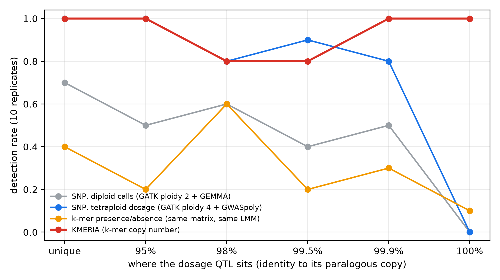
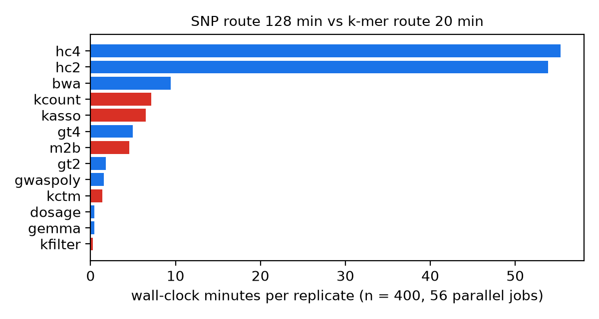

# kmeria-polyploid-demo

A preregistered, fully simulated test of one question: **when a QTL acts through allele dosage in an
autotetraploid, and sits in sequence that has a near-identical paralogous copy, which GWAS encodings can still see it?**

Four routes are run on the same reads and the same phenotypes: diploid SNP calls, tetraploid SNP dosage
(GWASpoly), k-mer presence/absence, and [KMERIA](https://github.com/Sh1ne111/KMERIA) k-mer copy number
(Nature Genetics 2026, doi:10.1038/s41588-026-02641-8). Predictions were written down in
[`PREREGISTRATION.md`](PREREGISTRATION.md) before any replicate ran; `git log -- PREREGISTRATION.md` shows they
were not edited afterwards (one dated amendment, made after the n = 20 smoke test and before the full runs).

> Simulated data only: 400 autotetraploid individuals, 2.5 Mb genome, 60× short reads, 10 replicates.
> The numbers here show *mechanisms*, not field-ready power estimates.



## The story in four steps

**1. Theoretical expectation.** At founder frequency 0.5 a diploid GT call correlates with true tetraploid dosage at
r ≈ 0.71, and k-mer presence/absence at r ≈ 0.52. A dosage-aware encoding should therefore find a 10 %-variance QTL
far more often than either of them.

**2. Empirical deviation, part 1.** The prediction holds in direction but not in size. Pooled over the five dosage QTLs
that a linear reference can still resolve (unique → 99.9 %), the detection rates are:

| encoding | detected (50 trait × replicate) |
|---|---|
| KMERIA (k-mer copy number) | **92 %** |
| GWASpoly (GATK ploidy 4 dosage) | **90 %** |
| SNP, diploid calls | 54 % |
| k-mer presence/absence | 34 % |

Presence/absence k-mers lose most of the signal, as predicted. Both lossy encodings do better than our forecast,
though (see the scorecard).

**3. Empirical deviation, part 2: the patch works, then hits a wall.** The obvious fix inside the alignment
paradigm is to call genotypes with ploidy 4 and run GWASpoly. It works much better than expected. In 8 of 10
replicates GATK still genotyped the causal site at **99.9 %** identity, with r = 0.84–0.98 against true dosage. A
2×150 bp read pair spans ~700 bp, so it almost always covers at least one distinguishing base. GWASpoly missed the
99.9 % QTL in exactly the 2 replicates where GATK did not call the site.

The wall is the **100 %-identical duplicate**. Reads from the two copies get MAPQ 0, HaplotypeCaller ignores them,
and the causal SNP was **not called in any of 10 replicates at either ploidy**. Every SNP-based route is blind there
(0/10), and presence/absence is nearly so (1/10). KMERIA found it **10/10** (median p = 2.9e-9; threshold 5.6e-7).
The causal alt allele exists on only one copy, so its k-mers are unique in the genome even though the reference
coordinates around them are not. The SNP panels of [the Manhattan plot](figures/fig4_manhattan_P100_seed1.png)
show an empty gap at the duplicated segment.

**4. Digesting the deviation.** In this simulation the difference is not "KMERIA has more power everywhere."
Where the reference can still place reads, GWASpoly is as good as KMERIA. What changes the result is *where the
genotype comes from*. SNP routes need a read to be uniquely placed before a genotype exists. A copy-number k-mer
matrix does not. That advantage is concentrated in exactly the regions (recent segmental duplications, collapsed
paralogs) that a linear reference cannot resolve.

The boundary control shows the reverse. For a **dominant** QTL (CTRL, founder frequency 0.1), presence/absence is
the only encoding that found it in 10/10 replicates, with the strongest signal (median −log10 p = 12.2). Diploid
calls found it in 9/10, and both additive dosage methods in 8/10 (median 9.0 for KMERIA, 8.4 for GWASpoly). When
1 and 3 copies have the same effect, an additive dosage model is the wrong model, and it shows.

## Prediction scorecard

| # | preregistered prediction | observed (10 replicates) | verdict |
|---|---|---|---|
| 1 | At U, snp_diploid ≈ 35–50 % and kmer_pa ≈ 5–10 %, dosage methods ≈ 95–98 % | snp_diploid 70 %, kmer_pa 40 %, gwaspoly 100 %, kmeria 100 % | **partly**. The direction holds, but both lossy encodings beat the forecast. The forecast ignored that the LMM absorbs the 20 % polygenic background, which raises the effective signal-to-noise ratio. |
| 2 | gwaspoly ≈ kmeria at U/P95, then loses power at P98 and P995 with ghost hits; kmeria flat | gwaspoly 100/100/80/90 % at U/P95/P98/P995, no ghosts; kmeria 100/100/80/80 % | **mostly failed** (already anticipated by Amendment 1). Most misses at P98/P995 by either method are within 10× of the threshold, which is power variance. One is a real mapping failure: at P995 in seed 9, GATK genotyped only 47 % of individuals (r = 0.69), and GWASpoly missed it (p = 2e-4). |
| 3 | CTRL: all detect; kmer_pa / snp_diploid at least as strong | kmer_pa 10/10, snp_diploid 9/10, gwaspoly 8/10, kmeria 8/10; median −log10 p 12.2, 11.2, 8.4, 9.0 | **second half holds, first half partly**: the dosage methods miss 2/10 (seeds 8 and 10) |
| 4 | GATK ploidy 4 is the most expensive step; kmeria cheaper end to end | HaplotypeCaller ploidy 4 = 55 min; GWASpoly route 72 min vs KMERIA route 20 min | **holds** |
| A1 | gwaspoly loses power at P999 and largely fails at P100; kmeria detects both | P999: gwaspoly 80 % (misses = the 2 replicates where GATK did not call the site), kmeria 100 %. P100: gwaspoly 0 %, kmeria 100 % | **P100 holds; P999 mostly failed** |

## What KMERIA costs here

Reported because a fair comparison has to show these too (all in [`results/summary.tsv`](results/summary.tsv)):

- **More false windows.** KMERIA averages 0.4 significant off-target 100 kb windows per trait per replicate. The
  SNP routes average 0.01–0.03. The 0.05/(M/31) threshold from the paper treats every 31 overlapping k-mers as one
  test, which is lenient when long haplotype blocks make millions of k-mers redundant.
- **Ghost signal.** Some replicates also had a significant peak within 50 kb of the paralogous copy: 1/10 at P100
  (seed 1, ~0.1 Mb; see the Manhattan plot), 2/10 at P98 and 1/10 at P95.
- **Most hits are not in the reference.** 76 % of significant true-window KMERIA k-mers at P100 do not occur in the
  linear reference (they carry the alt allele). Here they are placed with a perfect pangenome (all founder
  haplotypes). On real data, placing them is the hard part.
- **A tooling pitfall.** `kmeria filter --output-format txt` writes each k-mer string **reversed** (the 2-bit
  decoder emits the lowest bits first). The official compressed path used by the KMERIA wrapper is unaffected and is
  what the KMERIA route here uses. If you parse the text output yourself, reverse the strings before mapping them.

## Runtime (mean of 10 replicates, n = 400, 64-core VM, 56 parallel jobs)



| route | minutes |
|---|---|
| bwa-mem + GATK ploidy 2 + ploidy 4 + GEMMA + GWASpoly | 128 |
| GWASpoly only (bwa + GATK ploidy 4 + GWASpoly) | 72 |
| KMERIA (count → kctm → filter → m2b → kinship + association) | 20 |

That is about 3.6× here. The ~430× figure in the paper comes from real potato data against single-threaded
GATK and is not comparable.

## Design in one paragraph

Autotetraploid, 400 individuals, each homolog a mosaic of 60 founder haplotypes (mean block 25 kb). chr1 is 2 Mb
and chr2 is 0.5 Mb of random sequence with one SNP per 150 bp, substitutions only. Seven traits each have one major
QTL (10 % of variance), a shared chr2 polygenic background (20 %), and noise (70 %). The QTLs are:

- **U**: dosage QTL in unique sequence.
- **CTRL**: dominant QTL, founder frequency 0.1.
- **P95 / P98 / P995 / P999 / P100**: dosage QTLs inside 20 kb segments that have a paralogous copy at
  95 / 98 / 99.5 / 99.9 / 100 % identity.

Reads are wgsim 2×150 bp, 400 bp inserts, 60× monoploid. Scoring:

- **Thresholds**: Bonferroni for SNPs; 0.05/(M/31) for k-mers.
- **Detected**: a significant marker within ±50 kb of the causal site.
- **Ghost**: a significant marker only near the paralogous copy.
- **False windows**: 100 kb bins elsewhere on chr1.

## Reproduce

```bash
setup/install_envs.sh                        # micromamba envs: GATK, bwa, GEMMA, R + GWASpoly, KMERIA deps
pipelines/run_all.sh runs/main 1 10 400 56   # n = 20 check run, then seeds 1-10 (~2.6 h each on 64 cores)
python eval/aggregate.py runs/main . 1       # -> results/*.tsv, figures/*.png
python eval/test_place.py                    # self-test of k-mer placement
```

| path | what |
|---|---|
| `sim/` | genome, population, phenotypes (`simulate.py`), reads (`make_reads.py`) |
| `pipelines/run_rep.sh` | one replicate end to end, every stage timed |
| `eval/evaluate.py` | per-replicate scoring; `check_dosage.py` and `check_snp_calls.py` compare genotypes with the truth |
| `results/` | `summary.tsv` (per trait × method), `metrics_all.tsv` (per replicate), `runtime.tsv` |

## Limits

- Substitution-only, colinear simulation: no indels, structural variants or presence/absence variation. These would
  be the cases where k-mers are expected to gain further, and they are not tested here.
- k-mers are placed with a perfect pangenome, which real studies do not have.
- Ten replicates. A 10/10 result has a 95 % lower confidence bound of about 69 %.
- One sample size, one effect size, one k (31).
